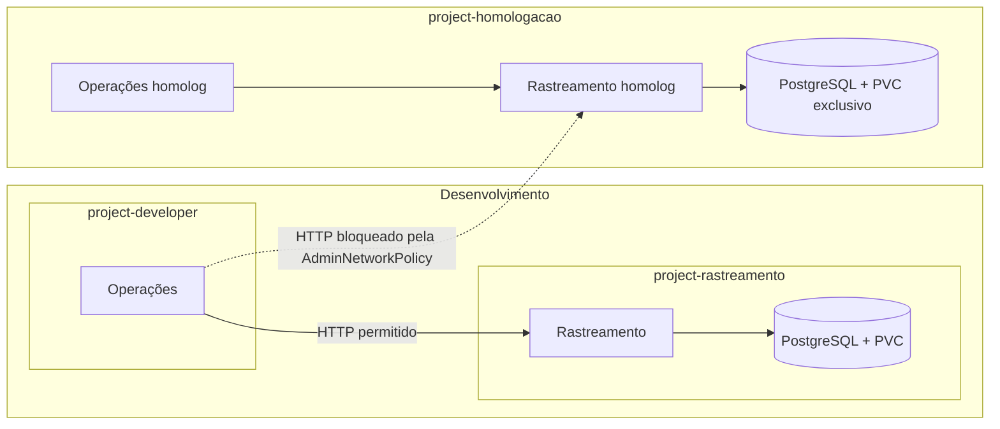

# Vértice Logística — PoC de plataforma com OpenShift

Uma prova de conceito para dar autonomia a dois times de desenvolvimento, controlar acessos e demonstrar operação de aplicações em OpenShift. A Vértice é um cliente fictício; as aplicações e os dados são demonstrativos.

Meu foco neste projeto foi a administração e a arquitetura da plataforma: transformar requisitos do cliente em configurações, testar o comportamento e investigar falhas. As aplicações modelo e parte da validação foram preparadas com apoio do Codex.

## O problema do cliente

Dois times, Operações e Rastreamento, compartilhavam infraestrutura e dependiam de intervenções manuais para publicar aplicações. O cliente precisava de permissões delimitadas, separação entre desenvolvimento e homologação, persistência dos dados e procedimentos de recuperação e troca de credenciais.

## Arquitetura implementada



Operações consulta e registra ocorrências pela API de Rastreamento. Apenas Rastreamento acessa o banco. Cada ambiente tem credenciais e armazenamento próprios. Homologação usa um namespace compartilhado pelos dois aplicativos: isso demonstra separação de ambientes, mas não reproduz integralmente a separação por time existente em desenvolvimento.

## O que demonstrei

| Cenário | Resultado e evidência |
|---|---|
| Acessos por grupos e RBAC | Consulta de suporte sem alteração; leitura cruzada específica entre times. Ver escopo abaixo. |
| Contenção de memória | Container com limite de 70 MiB encerrado por OOM; recuperação automática observada. |
| Comunicação necessária | Operações → Rastreamento retornou HTTP 200 dentro de dev e de homolog. |
| Bloqueio entre ambientes | Operações dev → Rastreamento homolog terminou em timeout, coerente com a regra inspecionada. |
| Troca de credenciais | Senha nova autenticou, antiga foi rejeitada e homologação continuou acessível. Executado em dev. |
| Persistência | Ocorrência permaneceu após substituição do pod PostgreSQL, validada manualmente. |
| Publicação defeituosa | Apps incluem versões com falha funcional e de readiness; roteiro disponível. |
| Entrada de novo time | Procedimento de onboarding documentado para repetição. |

[Registro de testes](docs/PROGRESSO-POC.md) · [Roteiro de validação](docs/VALIDACAO.md) · [Onboarding](docs/ONBOARDING.md)

Os testes de HTTP foram verificações funcionais curtas, não testes de carga. A execução integral de todos os requisitos foi confirmada pelo autor; o registro distingue as evidências coletadas no cluster dos testes relatados manualmente. Não há evidência detalhada de rollback ou onboarding completo anexada a esta versão.

## A descoberta mais útil: parecia rede, era memória

Durante a configuração de isolamento, Operações dev também deixou de consultar Rastreamento dev. O erro HTTP sugeria uma falha de comunicação. Ao reproduzir o acesso e correlacionar os horários dos reinícios, identifiquei, com apoio da investigação no cluster, que as três réplicas estavam sofrendo OOM.

O limite de 70 MiB, usado para demonstrar contenção, não sustentava o funcionamento observado. Ajustei o request para 75 MiB e o limite para 110 MiB. Na verificação posterior, cinco consultas retornaram HTTP 200 e as três réplicas permaneceram prontas, sem reinícios durante o teste.

**Aprendizado:** comprovar que um limite funciona não comprova que ele foi bem dimensionado. E uma falha vista na comunicação pode ter origem no processo que deveria responder.

[Leia a investigação](docs/INCIDENTE-MEMORIA-DEV.md).

## Como explorar o repositório

- `rastreamento/`: API Flask, integração com PostgreSQL e inicializador idempotente.
- `operacoes/`: interface web e backend que consulta Rastreamento.
- `deploy/apps.json` e `deploy/homologacao.json`: implantação inicial, anterior aos exercícios administrativos.
- `deploy/observado.json`: exportação sanitizada do estado observado na revisão, com imagens e metadados ajustados para portabilidade. Não contém Secrets.
- `docs/`: contexto, procedimentos e evidências.
- `tests/`: testes unitários e smoke integrado.

[Configuração, endpoints e construção das imagens](docs/APLICACOES.md) · [Reprodução](docs/REPRODUCAO.md)

## Escopo e próximos refinamentos

O snapshot de RBAC observado contém bindings de leitura, mas não comprova a autonomia completa de publicação pelos desenvolvedores nem todos os acessos planejados. O requisito original de homologação isolada também por time exige refinamento da topologia atual. A AdminNetworkPolicy demonstrada bloqueia uma origem e um destino específicos; não representa isolamento geral de desenvolvimento e homologação, nem valida acesso pelas URLs externas.

As aplicações não têm autenticação de usuário final. Use apenas dados fictícios. O laboratório não demonstra alta disponibilidade do banco, backup/restauração, estabilidade prolongada sob carga ou recuperação após exclusão de PVC. Estes são próximos passos, não capacidades de produção reivindicadas por esta PoC.

## Testes locais

```bash
python3 -m venv .venv
. .venv/bin/activate
pip install -r rastreamento/requirements.txt
python -m unittest discover -s tests -v
```

O smoke integrado insere uma ocorrência sintética. Consulte `tests/smoke.py --help` para informar as URLs.
