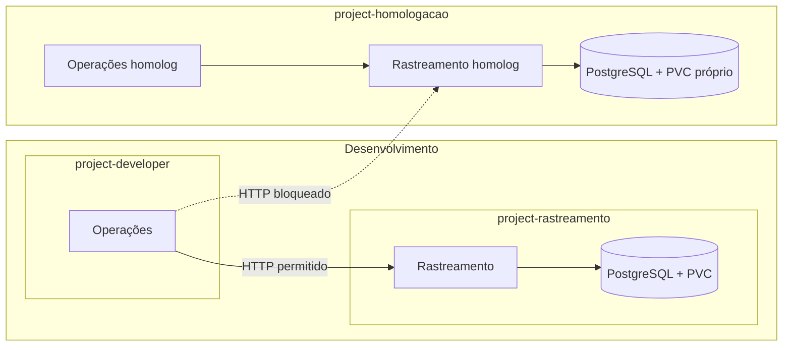

# Vértice Logística — PoC com OpenShift

[](https://github.com/rossettimateus/vertice-openshift-poc/actions/workflows/tests.yml)

Parti de um cluster OpenShift já disponível e de um cenário de cliente fictício: a Vértice Logística precisava organizar dois sistemas, Operações e Rastreamento, em desenvolvimento e homologação.

A partir desse pedido, defini a distribuição dos projetos, configurei os acessos e as regras de comunicação e testei os fluxos das aplicações. Usei aplicações modelo para validar o comportamento da plataforma.

## O que o cliente precisava

Os desenvolvedores dependiam da infraestrutura para publicar aplicações e investigar problemas. Havia acessos excessivos, configurações manuais e preocupação com uma aplicação consumir recursos a ponto de afetar as demais.

A partir desse cenário, organizei os testes em torno destes pontos:

- Acessos organizados por time e função, com suporte consultando diagnóstico sem alterar as aplicações.
- Desenvolvimento e homologação com dados e credenciais separados.
- Comunicação entre Operações e Rastreamento no mesmo ambiente.
- Bloqueio de Operações dev para Rastreamento homolog.
- Controle de memória e recuperação após falhas.
- Troca de credenciais e preservação de dados quando o pod do banco fosse substituído.
- Um procedimento para receber novos usuários e times.

[Cenário e matriz de requisitos](docs/REQUISITOS.md) · [Arquitetura e implantação](docs/IMPLANTACAO.md) · [Resultados](docs/RESULTADOS.md)

## O ambiente que montei

Trabalhei em um cluster com OVN-Kubernetes e armazenamento EBS CSI. Separei os aplicativos de desenvolvimento em dois projetos. Para homologação, usei um terceiro projeto com uma cópia dos dois aplicativos e um banco próprio.

| Projeto | Componentes |
|---|---|
| `project-developer` | Operações dev |
| `project-rastreamento` | Rastreamento dev, PostgreSQL e PVC |
| `project-homologacao` | Operações homolog, Rastreamento homolog, PostgreSQL e PVC próprios |



Operações envia as consultas e os registros de ocorrências para a API de Rastreamento. A API faz o acesso ao PostgreSQL; Operações não recebe as credenciais do banco.

Usei o provedor HTPasswd já configurado no ambiente para os usuários. Organizei as permissões com grupos e bindings de RBAC. Para a comunicação entre ambientes, configurei uma AdminNetworkPolicy selecionando a origem e o destino pelos namespaces e labels dos pods.

Em homologação, os aplicativos compartilham um namespace. Para ampliar essa estrutura, eu separaria os ambientes também por time e revisaria a matriz de permissões antes de receber novas equipes.

## Como testei

| Necessidade | Teste realizado | Resultado |
|---|---|---|
| Acesso de suporte | Consultar pods, eventos e logs; verificar permissões de alteração e leitura de Secrets | Leitura de diagnóstico permitida; ações verificadas de alteração e leitura de Secrets negadas |
| Comunicação em desenvolvimento | Consultar Rastreamento a partir de Operações dev | HTTP 200 em cinco consultas consecutivas |
| Comunicação em homologação | Consultar Rastreamento a partir de Operações homolog | HTTP 200 em três consultas consecutivas |
| Bloqueio entre ambientes | Consultar Rastreamento homolog a partir de Operações dev | Timeout, com a regra de bloqueio aplicada |
| Limite de memória | Tentar alocar memória acima do limite do container | OOMKilled e reinício do container |
| Troca de senha do banco | Atualizar a credencial e testar a senha nova e a antiga | Nova autenticou; antiga foi rejeitada; homologação continuou acessível |
| Persistência | Registrar uma ocorrência e substituir o pod PostgreSQL | A ocorrência permaneceu disponível |

A troca de credenciais foi feita em desenvolvimento. Na parte de recuperação de versão, as aplicações incluem imagens com falhas controladas de readiness e de negócio. Deixei o roteiro de execução e o procedimento de entrada de um novo time na documentação.

[Testes e resultados](docs/RESULTADOS.md) · [Roteiro do laboratório](docs/VALIDACAO.md) · [Entrada de novos times](docs/ONBOARDING.md)

## O problema que mais me ensinou

Enquanto configurava o isolamento, Operações dev parou de consultar Rastreamento dev. Minha primeira suspeita foi a rede, porque era justamente a configuração em que eu estava trabalhando.

A investigação mostrou que as requisições chegavam aos pods, mas os containers morriam por falta de memória. O limite de 70 MiB usado no exercício de contenção era baixo demais para o funcionamento da aplicação.

Ajustei o request para 75 MiB e o limite para 110 MiB. Repetimos as consultas: desenvolvimento voltou a responder, homologação continuou funcionando e o acesso indevido entre os ambientes permaneceu bloqueado. As três réplicas de Rastreamento dev ficaram prontas, sem reinícios durante essa verificação.

Eu estava procurando um problema de rede e não tinha pensado em memória. Acompanhar os reinícios junto da requisição foi o que ajudou a entender a falha.

[Relato e comandos usados na investigação](docs/INCIDENTE-MEMORIA-DEV.md).

## O que está no repositório

- `rastreamento/` e `operacoes/`: aplicações modelo, preparadas com apoio do Codex.
- `deploy/apps.json` e `deploy/homologacao.json`: implantação inicial das aplicações.
- `deploy/observado.json`: configurações exportadas do laboratório, sem Secrets e com referências ajustadas para reprodução.
- `docs/`: requisitos do cliente, decisões de arquitetura, implantação e resultados dos testes.
- `tests/`: testes unitários e smoke integrado.

[Como reproduzir](docs/REPRODUCAO.md) · [Configuração das aplicações](docs/APLICACOES.md)

## O que ainda quero melhorar

A PoC usa dados fictícios e testes funcionais curtos. Para evoluir a solução, eu trabalharia em testes de carga, backup e restauração, alta disponibilidade do banco e automação do onboarding. Também ampliaria os testes de isolamento para outros workloads e caminhos de acesso, além do fluxo interno demonstrado aqui.

Os manifests de RBAC disponíveis registram os bindings de leitura do laboratório. Para reproduzir a autonomia completa dos desenvolvedores, é necessário completar as permissões conforme a matriz de acesso do ambiente.

## Testes locais

```bash
python3 -m venv .venv
. .venv/bin/activate
pip install -r rastreamento/requirements.txt
python -m unittest discover -s tests -v
```

O smoke integrado insere uma ocorrência sintética. Execute `python tests/smoke.py --help` para informar as URLs.
