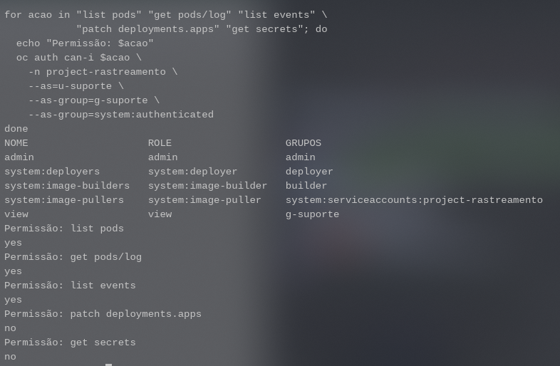
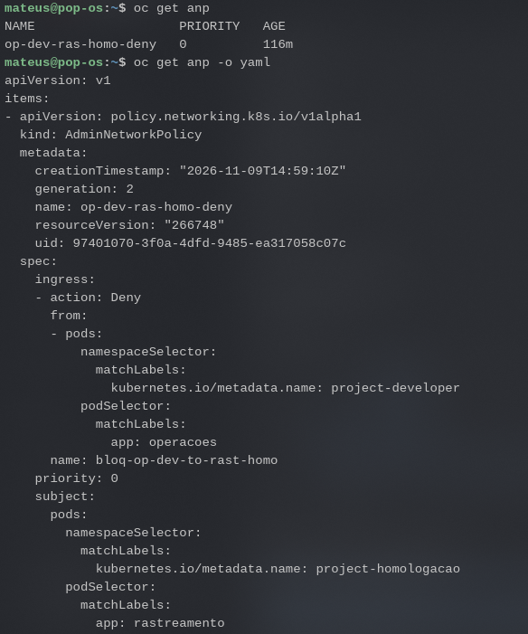

# Testes e resultados

Executei os testes com os dois ambientes disponíveis no cluster. Abaixo estão os resultados que usei para avaliar a PoC.

## Acesso do suporte

O grupo `g-suporte` estava associado à role `view` em `project-rastreamento`. A consulta de permissões retornou `yes` para pods, logs e eventos, e `no` para alteração de Deployments e leitura de Secrets.

## Acessos dos times em desenvolvimento

Na revisão final, os grupos já existiam, mas faltavam os bindings para trabalhar nas próprias aplicações. O RBAC foi complementado com `edit` no próprio projeto e `view` no projeto do outro time.

| Grupo | Projeto | Pods e logs | Criar/alterar Deployments | Ler Secrets |
|---|---|---|---|---|
| `g-developer` | `project-developer` | Sim | Sim | Sim |
| `g-developer` | `project-rastreamento` | Sim | Não | Não |
| `g-rastreamento` | `project-rastreamento` | Sim | Sim | Sim |
| `g-rastreamento` | `project-developer` | Sim | Não | Não |
| `g-suporte` | Os dois projetos de desenvolvimento | Sim | Não | Não |

A role `edit` concede acesso aos Secrets do próprio projeto. Essa escolha atende ao escopo de desenvolvimento desta configuração; para separar também os Secrets do próprio time, seria necessário revisar o modelo de acesso.

As permissões foram consultadas com `oc auth can-i`, usando os usuários e grupos correspondentes. Nenhuma operação de escrita foi executada para testar os Deployments. Em `project-homologacao`, os três grupos não têm as permissões verificadas acima. Esse ambiente é operado pelo acesso administrativo do laboratório nesta versão.

[Saída das verificações](evidencias/rbac-verificacao.json).

## Comunicação entre aplicações

| Origem | Destino | Resultado |
|---|---|---|
| Operações dev | Rastreamento dev | Cinco consultas HTTP 200 |
| Operações homolog | Rastreamento homolog | Três consultas HTTP 200 |
| Operações dev | Rastreamento homolog | Timeout |

A primeira versão da AdminNetworkPolicy selecionava os pods `app=operacoes` de todos os namespaces. Isso também bloqueou Operações homolog. Corrigi o seletor de origem para `project-developer` e repeti os testes.

A configuração da regra ficou assim:

As consultas usaram HTTP pelo DNS dos Services. O ping ajudou em verificações pontuais, mas não substituiu o teste do protocolo usado pela aplicação.

## Contenção de memória

O teste com limite de `70Mi` resultou em `OOMKilled` e reinício do container. Mais tarde percebi que o valor também afetava as consultas normais. Ajustei o request para `75Mi` e o limite para `110Mi`; as três réplicas permaneceram prontas e sem novos reinícios durante a repetição das consultas.

O [relato do incidente](INCIDENTE-MEMORIA-DEV.md) reúne os comandos, os erros e o caminho da investigação.

## Troca da credencial do PostgreSQL

Fiz a atualização do Secret `rastreamento-db` em `project-rastreamento` e reiniciei o rollout da API. A mudança foi coordenada com a alteração da senha do usuário no PostgreSQL.

Depois da troca:

- A nova senha autenticou e permitiu consultar as entregas.
- A senha antiga foi rejeitada por falha de autenticação.
- Operações conseguiu registrar uma ocorrência e Rastreamento conseguiu consultá-la.
- O banco de homologação continuou acessível com sua própria credencial.

O principal cuidado foi entender que atualizar o Secret não altera a senha dentro de um banco já inicializado. As duas mudanças precisam ser coordenadas.

## Persistência após substituição do pod

Registrei uma ocorrência pela interface de Operações, excluí somente o pod PostgreSQL de desenvolvimento e aguardei o substituto ficar disponível. Depois consultei a entrega novamente: a ocorrência continuava lá.

O novo pod montou o armazenamento pelo PVC existente. Não excluí o PVC nem o PV. O exercício demonstrou persistência após substituir o pod do banco; backup e restauração são uma próxima etapa.

## Procedimentos do laboratório

O [roteiro de validação](VALIDACAO.md) inclui publicação de versões com falha controlada e recuperação da aplicação. O [documento de onboarding](ONBOARDING.md) organiza a entrada de usuários e de um terceiro time.

As verificações de HTTP e autenticação foram feitas com apoio do Codex. O teste de persistência foi acompanhado pela interface da aplicação.
